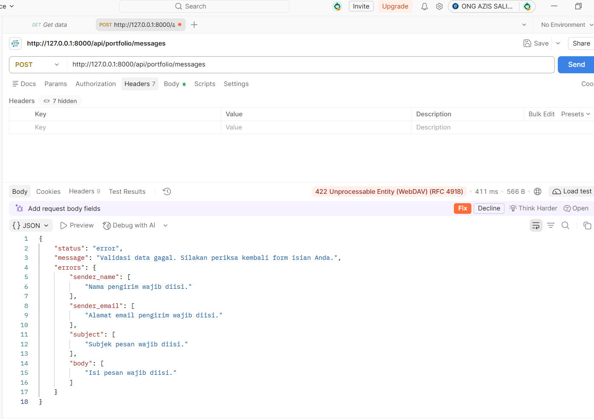
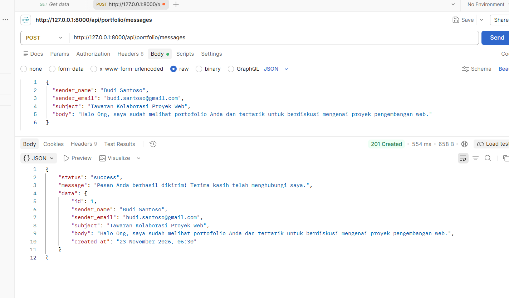
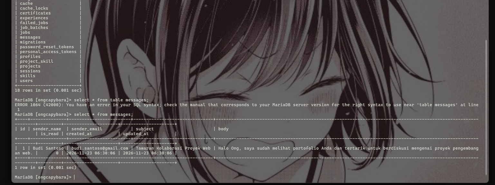

---

## 📌 Latihan 5b (`Lat-5b_RestAPI_POST`) — RESTful API POST Endpoint & Validasi FormRequest

### 1. Arsitektur Validasi & Keamanan Endpoint

- **Endpoint:** `POST /api/portfolio/messages`
- **Form Request Validation (`StoreMessageRequest`):** Memisahkan logika otorisasi (`authorize(): true`) dan validasi input (`required`, `email:rfc,dns`, batasan panjang `min`/`max`) dari controller. Jika validasi gagal, sistem otomatis mengembalikan JSON berstatus **`422 Unprocessable Entity`** dengan pesan kesalahan Bahasa Indonesia.
- **Sanitasi & Keamanan Data:** Menggunakan `$request->validated()`, pembersihan tag HTML via `strip_tags()` untuk mencegah _Stored XSS_, pembatasan `$fillable` pada model `Message` agar kolom `is_read` tidak dapat dimanipulasi klien, serta proteksi _Rate Limiting_ `throttle:5,1` (maksimal 5 request per menit)[cite: 4].
- **Standar HTTP Status `201 Created`:** Mengembalikan kode status `201` beserta payload data baru saat pesan berhasil disimpan ke MySQL[cite: 4].

### 2. Bukti Pengujian Postman & Database MySQL

**Skenario Negatif — Validasi Gagal (`422 Unprocessable Entity`):**

**Skenario Positif — Pesan Berhasil Tersimpan (`201 Created`):**

**Verifikasi Data Masuk di Tabel `messages` MySQL:**

