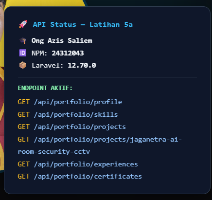

### 1. Perbedaan Aktivasi Routing API: Laravel 10 vs Laravel 11+
- **Laravel 10:** Berkas `routes/api.php` dan middleware `api` sudah tersedia serta terdaftar secara bawaan sejak awal instalasi melalui `app/Http/Kernel.php`.
- **Laravel 11+ (Slim Skeleton):** Berkas `routes/api.php` tidak disertakan secara default agar struktur proyek tetap ramping. Routing API diaktifkan secara eksplisit melalui perintah `php artisan install:api`, yang otomatis membuat `routes/api.php`, mendaftarkannya ke `bootstrap/app.php`, serta memasang `laravel/sanctum`[cite: 4].

### 2. Penjelasan N+1 Query Problem & Solusi Eager Loading (`with()`)
- **N+1 Query Problem:** Terjadi ketika pengambilan 1 query daftar induk (misalnya 10 data `Project`) memicu N query tambahan di dalam perulangan untuk mengambil data relasinya (`$project->skills`) satu per satu, sehingga total query membengkak menjadi $1 + N$ query[cite: 4].
- **Solusi (`Project::with('skills')`):** Eloquent melakukan *Eager Loading* dengan hanya menjalankan **2 query SQL** (1 query mengambil daftar proyek, 1 query mengambil seluruh skill terkait menggunakan klausa `WHERE project_id IN (...)`), sehingga waktu respons API jauh lebih cepat dan konsisten[cite: 4].

### 3. Daftar Endpoint GET Aktif (`/api/portfolio`)
- `GET /api/portfolio/profile` — Mengambil data profil utama pemilik portofolio[cite: 4].
- `GET /api/portfolio/skills` — Mengambil daftar keahlian teknis terurut berdasarkan kategori[cite: 4].
- `GET /api/portfolio/projects` — Mengambil daftar proyek beserta relasi `skills`[cite: 4].
- `GET /api/portfolio/projects/{slug}` — Mengambil detail proyek berdasarkan `slug` unik (`404` jika tidak ditemukan)[cite: 4].
- `GET /api/portfolio/experiences` — Mengambil riwayat pendidikan, organisasi, dan pengalaman kerja[cite: 4].
- `GET /api/portfolio/certificates` — Mengambil daftar sertifikat dan penghargaan[cite: 4].

### 4. Bukti Panel Status API & Pengujian Endpoint (Postman / Thunder Client)
**Panel API Status pada Halaman Utama:**

**Pengujian Endpoint GET Sukses (`200 OK`):**

**Pengujian Error Handling Slug Tidak Valid (`404 Not Found`):**

