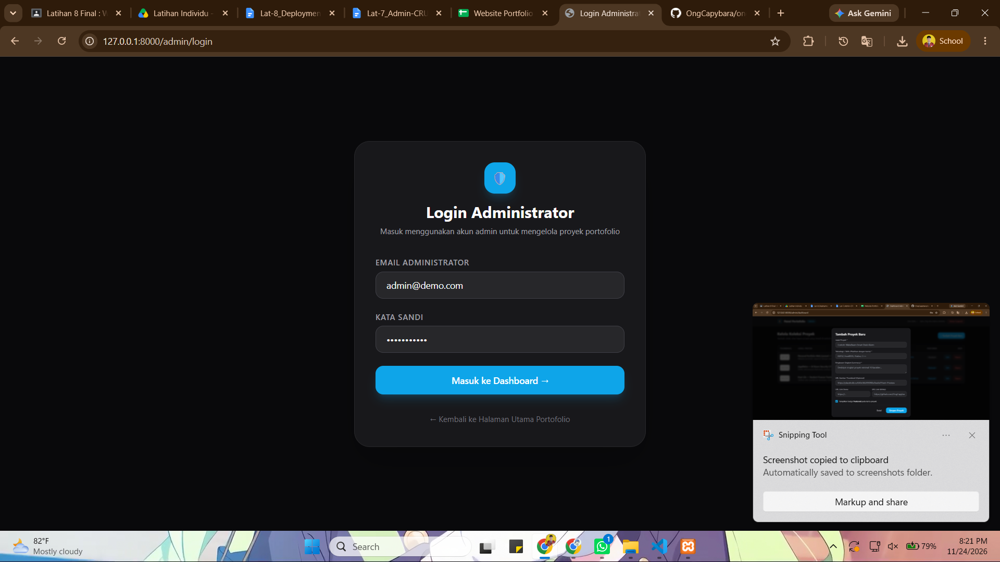
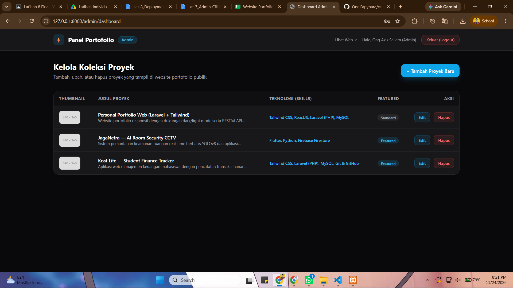
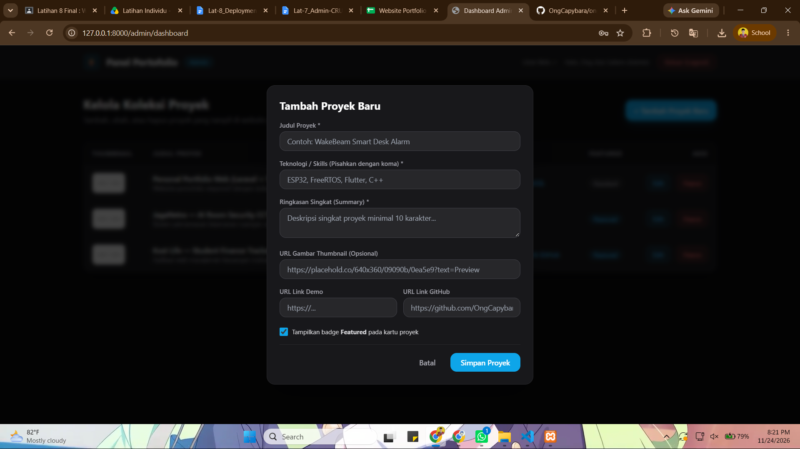
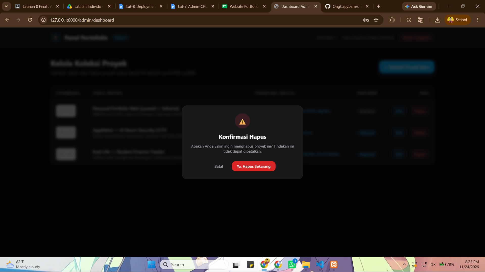
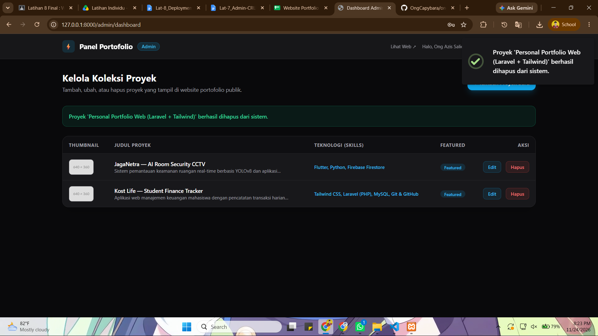

---

## 🔑 Akun Demo Pengujian Admin (Latihan 7 — `Lat-7_AdminCRUD`)

- **URL Login Admin :** `http://127.0.0.1:8000/admin/login`
- **Email Admin :** `admin@demo.com`
- **Kata Sandi :** `password123`

### 1. Fitur Keamanan & CRUD yang Diimplementasikan

- **Laravel Sanctum Token Auth:** Endpoint `POST /api/login` menerbitkan _Bearer Token_ (`personal_access_tokens`), dan `POST /api/logout` mencabut sesi token aktif.
- **Middleware Proteksi (`auth:sanctum`):** Seluruh rute mutasi `/api/admin/projects` otomatis menolak request tanpa token valid dengan status **`401 Unauthorized`**.
- **Admin Dashboard CRUD (`public/js/admin.js`):** Mendukung operasi _Create_ (`201 Created`), _Read_ (`200 OK`), _Update_ (`200 OK`) lengkap dengan _Live Image Preview_, serta _Delete_ (`200 OK`) yang dilindungi dialog konfirmasi aman.

### 2. Bukti Pengujian Visual

**1. Halaman Login Admin & Token Sanctum:**

**2. Dashboard Admin CRUD Koleksi Proyek:**

**3. Modal Konfirmasi Hapus & Notifikasi Sukses:**

