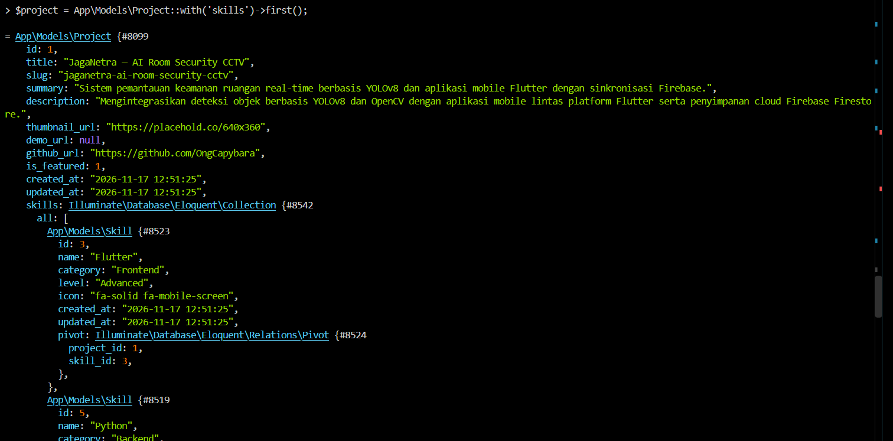
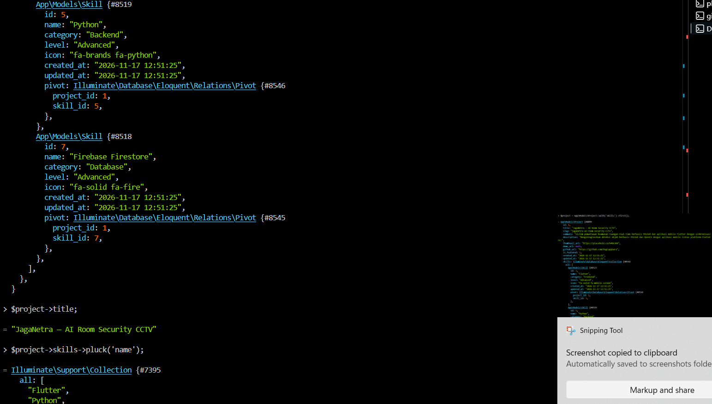
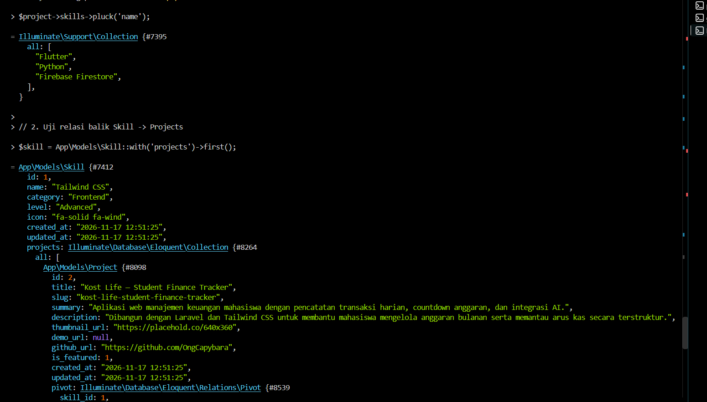
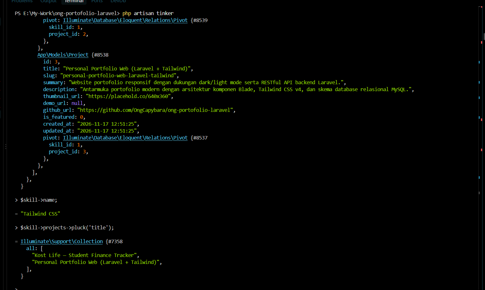
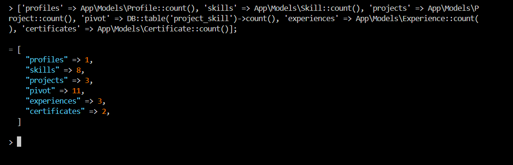
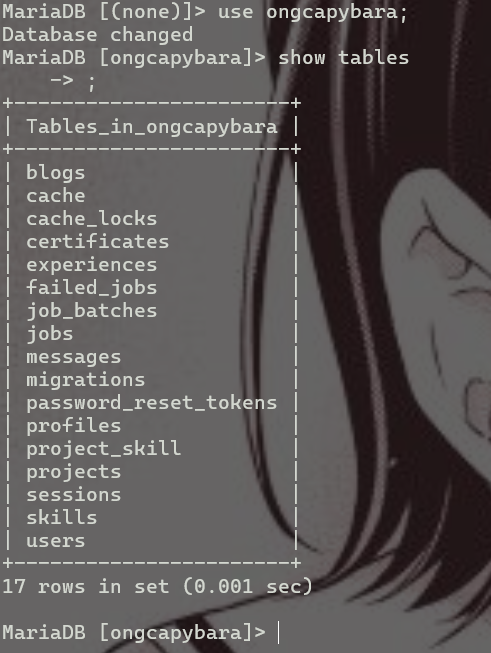

# Website Portofolio — Praktikum Pemrograman Web 2

- **Nama:** Ong Azis Saliem
- **NPM:** [ISI_NPM_KAMU]
- **Kelas:** [ISI_KELAS_KAMU]
- **Program Studi:** S1 Informatika — Universitas Teknokrat Indonesia
- **Repository:** [ong-portofolio-laravel](https://github.com/OngCapybara/ong-portofolio-laravel)

---

## 📌 Latihan 4a (`Lat-4a_SetupLaravel`) — Setup Laravel & Konfigurasi MySQL

### 1. Pilihan Versi PHP & Laravel

- **PHP 8.3+:** Dipilih karena merupakan _sweet spot_ industri dengan keseimbangan optimal antara performa, keamanan, serta pengetatan tipe data (_strict typing_) dan kompatibilitas penuh dengan seluruh dependensi modern[cite: 4, 5].
- **Laravel 11.x:** Dipilih karena struktur direktori `app/` yang lebih ramping (_slim skeleton_), mendukung pembuatan database otomatis (_auto-creation_) saat menjalankan migrasi, serta siap dikembangkan menjadi RESTful API[cite: 5, 14].

### 2. Struktur Folder Penting Laravel

1. **`app/`**: Berisi inti logika aplikasi, mencakup `Http/Controllers/` (pengatur alur _request_) dan `Models/` (representasi tabel database menggunakan Eloquent ORM)[cite: 12].
2. **`routes/`**: Tempat mendefinisikan jalur URL aplikasi (`web.php` untuk rute tampilan web dan `api.php` untuk _endpoint_ RESTful API)[cite: 13].
3. **`resources/views/`**: Menyimpan berkas _template_ antarmuka pengguna berbasis Blade (`.blade.php`) beserta komponen modularnya[cite: 13].
4. **`database/`**: Berisi berkas `migrations/` (skema tabel database), `seeders/` (pengisi data awal), dan `factories/` (generator data _dummy_)[cite: 12, 13].
5. **`config/` & `.env`**: `config/` mengatur konfigurasi global framework, sedangkan `.env` menyimpan kredensial sensitif lingkungan lokal (koneksi MySQL, `APP_KEY`) yang diisolasi melalui `.gitignore`[cite: 12, 13].

### 3. Perintah Artisan CLI yang Digunakan

1. `php artisan serve` — Menjalankan server pengembangan lokal Laravel (`http://127.0.0.1:8000`)[cite: 18].
2. `php artisan migrate` — Mengeksekusi seluruh berkas migrasi untuk membuat tabel ke dalam database MySQL[cite: 18].
3. `php artisan migrate:fresh --seed` — Menghapus seluruh tabel, membangun ulang skema migrasi dari awal, lalu menjalankan _seeder_[cite: 19, 34].
4. `php artisan config:clear` — Membersihkan _cache_ konfigurasi agar perubahan pada berkas `.env` langsung terbaca oleh sistem[cite: 19].
5. `php artisan tinker` — Membuka REPL interaktif untuk menguji koneksi database maupun relasi model Eloquent secara langsung[cite: 34].

### 4. Bukti Kartu Identitas & Koneksi Database MySQL

---

## 📌 Latihan 4b (`Lat-4b_DatabaseModel`) — Desain Database, Model Eloquent & Seeder

### 1. Skema Basis Data (7 Tabel & Relasi Many-to-Many)

- **`profiles`**: Menyimpan data identitas utama mahasiswa (`full_name`, `headline`, `bio`, `photo_url`, `cv_url`, kontak, dan tautan sosial media)[cite: 34].
- **`skills`**: Menyimpan daftar keahlian teknis yang dikelompokkan dalam kategori `Frontend`, `Backend`, `Database`, dan `Tools` beserta tingkat penguasaan (`level`)[cite: 34].
- **`projects`**: Menyimpan daftar karya/proyek portofolio beserta `slug` unik, ringkasan, deskripsi lengkap, tautan demo, GitHub, dan penanda `is_featured`[cite: 34].
- **`project_skill` (Tabel Pivot)**: Menghubungkan relasi _Many-to-Many_ (`belongsToMany`) antara `projects` dan `skills` menggunakan _foreign key_ (`project_id` & `skill_id`) dengan aturan `cascadeOnDelete()` serta indeks unik komposit[cite: 34].
- **`experiences`**: Menyimpan lini masa riwayat pendidikan, organisasi, magang, maupun pekerjaan (`type`, `start_date`, `end_date`, `is_current`)[cite: 34].
- **`certificates`**: Menyimpan daftar sertifikasi dan penghargaan beserta lembaga penerbit (`issuer`), tanggal terbit, dan tautan kredensial[cite: 34].
- **`messages`**: Menyimpan pesan masuk dari formulir kontak pengunjung dengan status baca (`is_read`) dan proteksi _mass assignment_ `$fillable`[cite: 34].

### 2. Bukti Eksekusi Database & Pengujian Relasi Tinker

**Struktur & Data Tabel di Database MySQL:**

**Pengujian Relasi Many-to-Many via Artisan Tinker:**

---

## 📌 Latihan 5a (`Lat-5a_RestAPI_GET`) — RESTful API GET Endpoints Portofolio

### 1. Perbedaan Aktivasi Routing API: Laravel 10 vs Laravel 11+
- **Laravel 10:** Berkas `routes/api.php` dan middleware `api` sudah tersedia serta terdaftar secara bawaan sejak awal instalasi melalui `app/Http/Kernel.php`.
- **Laravel 11+ (Slim Skeleton):** Berkas `routes/api.php` tidak disertakan secara default agar struktur proyek tetap ramping. Routing API diaktifkan secara eksplisit melalui perintah `php artisan install:api`, yang otomatis membuat `routes/api.php`, mendaftarkannya ke `bootstrap/app.php`, serta memasang `laravel/sanctum`[cite: 4].

### 2. Penjelasan N+1 Query Problem & Solusi Eager Loading (`with()`)
- **N+1 Query Problem:** Terjadi ketika pengambilan 1 query daftar induk (misalnya 10 data `Project`) memicu N query tambahan di dalam perulangan untuk mengambil data relasinya (`$project->skills`) satu per satu, sehingga total query membengkak menjadi $1 + N$ query[cite: 4].
- **Solusi (`Project::with('skills')`):** Eloquent melakukan *Eager Loading* dengan hanya menjalankan **2 query SQL** (1 query mengambil daftar proyek, 1 query mengambil seluruh skill terkait menggunakan klausa `WHERE project_id IN (...)`), sehingga waktu respons API jauh lebih cepat dan konsisten[cite: 4].

### 3. Daftar Endpoint GET Aktif (`/api/portfolio`)
- `GET /api/portfolio/profile` — Mengambil data profil utama pemilik portofolio[cite: 4].
- `GET /api/portfolio/skills` — Mengambil daftar keahlian teknis terurut berdasarkan kategori[cite: 4].
- `GET /api/portfolio/projects` — Mengambil daftar proyek beserta relasi `skills`[cite: 4].
- `GET /api/portfolio/projects/{slug}` — Mengambil detail proyek berdasarkan `slug` unik (`404` jika tidak ditemukan)[cite: 4].
- `GET /api/portfolio/experiences` — Mengambil riwayat pendidikan, organisasi, dan pengalaman kerja[cite: 4].
- `GET /api/portfolio/certificates` — Mengambil daftar sertifikat dan penghargaan[cite: 4].

### 4. Bukti Panel Status API & Pengujian Endpoint (Postman / Thunder Client)
**Panel API Status pada Halaman Utama:**

**Pengujian Endpoint GET Sukses (`200 OK`):**

**Pengujian Error Handling Slug Tidak Valid (`404 Not Found`):**

