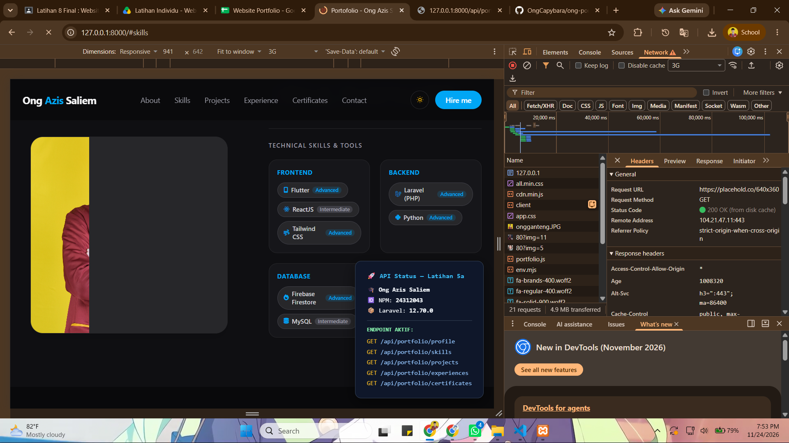
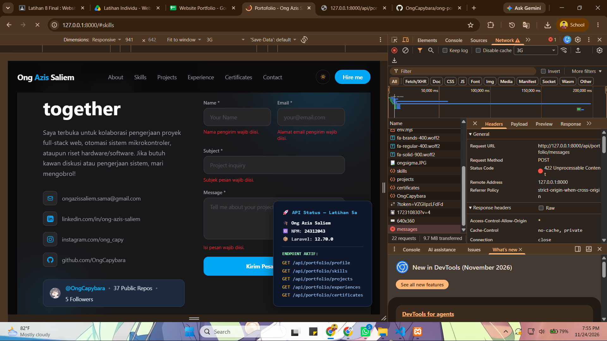
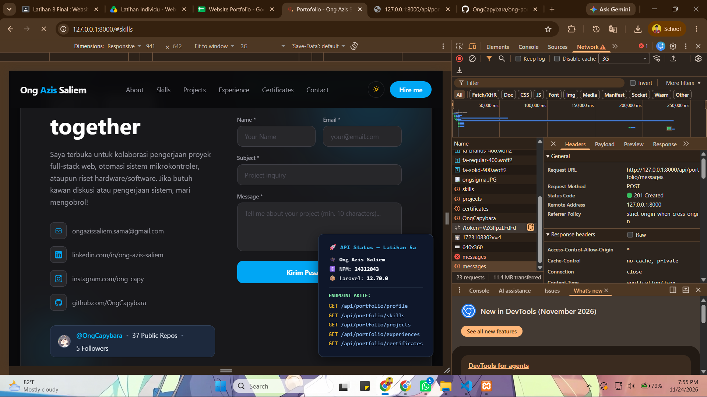

---

## 📌 Latihan 6 (`Lat-6_FetchIntegrasi`) — Integrasi Frontend & Backend via Asynchronous Fetch API

### 1. Cara Menjalankan Proyek (Panduan Penguji)
1. `composer install`
2. `cp .env.example .env` lalu sesuaikan konfigurasi database MySQL
3. `php artisan key:generate`
4. `php artisan migrate:fresh --seed`
5. `php artisan serve` (buka `http://127.0.0.1:8000`)

### 2. Fitur Utama yang Diimplementasikan (`public/js/portfolio.js`)
- **Dynamic Rendering (`GET`):** Mengambil data *Skills*, *Projects*, dan *Certificates* dari endpoint `/api/portfolio/...` secara asinkron menggunakan `async/await` dan `fetch()` dengan header `Accept: application/json`.
- **State Management UX:** Menerapkan *Shimmer Skeleton Loading* (`animate-pulse`), *Empty State*, *Error State*, serta gambar cadangan otomatis (`onerror` fallback).
- **Debounced Live Search:** Input pencarian pada bagian proyek menyaring judul, ringkasan, maupun teknologi dengan jeda `debounce(400ms)` agar bebas *lag*.
- **Asynchronous Contact Form (`POST`):** Mengirim payload JSON ke `POST /api/portfolio/messages`, menampilkan *spinner* pada tombol saat proses berjalan, menangkap kegagalan validasi **`HTTP 422 Unprocessable Entity`** secara *inline* di bawah masing-masing input, dan menampilkan notifikasi *toast* sukses **`HTTP 201 Created`**.
- **Integrasi GitHub REST API Publik:** Menarik avatar, jumlah repositori publik, dan jumlah *followers* dari `https://api.github.com/users/OngCapybara`.

### 3. Bukti Pengujian Visual
**1. Shimmer Loading Skeleton State:**

**2. Penanganan Validasi Form Inline (`422 Unprocessable Entity`):**

**3. Pengiriman Pesan Sukses (`201 Created` Toast) & Widget GitHub API:**

